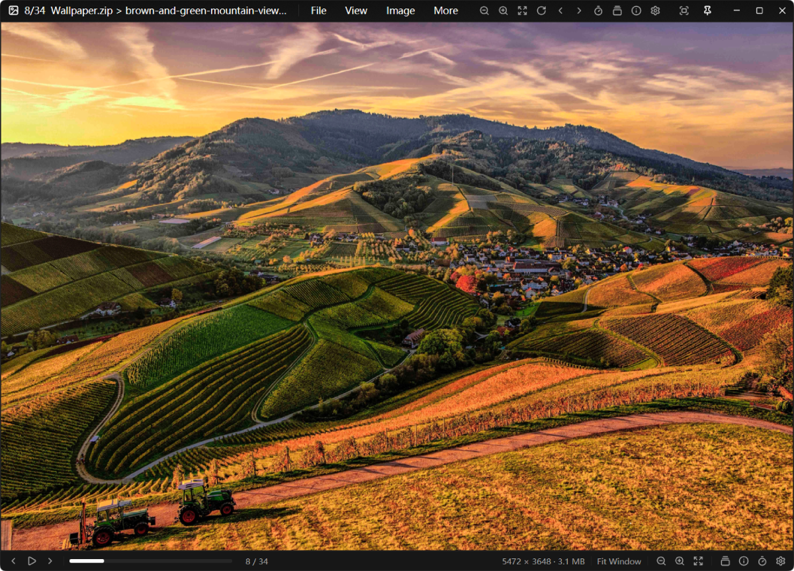

# SeePic

<p align="center">
  
</p>

<p align="center">
  English · <a href="README_CN.md">简体中文</a>
</p>

SeePic is a desktop image viewer and comic reader for Windows, written in **Rust + GPUI**. It is built around three priorities: open quickly, turn pages without lag, and keep memory bounded while browsing very large folders, high-resolution photographs, and whole comics stored in ZIP / 7Z / RAR / TAR archives.

## Highlights

- **Archives without extraction** — archives are indexed from their directory and read on demand. Parsing the central directory of a 688 MB ZIP takes about 1.6 ms instead of scanning the whole file.
- **Large folders stay responsive** — thumbnails are decoded only for the cells that are visible. JPEG thumbnails use DCT scaling, the image is resized once with CatmullRom, and scrolling does not repeatedly evict and re-decode the same tiles.
- **Animations play properly** — GIF and animated WebP play frame by frame, with pause and single-frame stepping. Animated WebP shows its first frame immediately and decodes the rest in the background.
- **Bounded memory** — thumbnail and page textures share one budget, and large decoded frames can live in mapped temporary files, so reading a long comic does not grow the process without limit.

## Features

- **Image formats**: JPEG, PNG, GIF, WebP, BMP, TIFF, TGA, PNM, DDS, HDR, EXR, QOI, ICO and more.
- **Archives**: ZIP / CBZ, 7Z / CB7, RAR / CBR and TAR / CBT, including encrypted archives with a password prompt.
- **View modes**: actual size (100%), fit window, fit width, fit height, smart two-page spreads (left-to-right and right-to-left), and vertical webtoon scrolling.
- **Thumbnails**: a filmstrip below the image and a full-screen thumbnail grid, with A–Z jumping on the left and an auto-hiding scrollbar on the right.
- **Reading position**: reopening a folder or archive returns to the page you last viewed.
- **Bookmarks**: add the current image, open the most recent bookmark, or browse all bookmarks in a separate window.
- **Image tools**: rotate, flip, reset, filters, interpolation, brightness / contrast / saturation / gamma, grayscale, sepia, per-channel viewing, a batch image converter, and “save as seen”.
- **Clipboard**: copy the displayed image, copy or cut the image file, and paste files or bitmap data into the folder being browsed.
- **System integration**: register SeePic as an image / comic handler, and add “Browse with SeePic” and “Convert with SeePic” to Explorer’s context menu.
- **Interface language**: follow the Windows display language, or pick one in Settings — Simplified Chinese, Traditional Chinese, English, Japanese, Korean, French, German, Spanish, Russian or Portuguese. Untranslated entries fall back to English.

## Browsing a folder or archive

Open a file with **Open File**, open a directory with **Open Folder**, or drop a file or folder onto the window. A single image opens inside its folder, so the neighbouring images are available immediately; an archive opens as a page list. Use the arrow keys or the mouse wheel to move through images, and the filmstrip or thumbnail grid to jump elsewhere.

The title bar shows the container, the current file and the position. The status bar shows the image size and the current sort order. All of these can be configured in the settings.

## Keyboard and mouse

Every command is available from the menu bar, the command palette (`Ctrl+Shift+P`), and the settings window. The default key bindings are listed and can be changed in **Settings → Keyboard**; mouse bindings live under **Settings → Mouse**. The right-click menu exposes the same commands with their current shortcuts.

## Building

Requirements: Rust 1.85+ (edition 2024) on Windows 10/11.

```text
cargo build --release
target\release\seepic.exe <image, folder or archive>
```

Release builds use the Windows GUI subsystem, so launching from Explorer does not open a console window. A packaged build is placed in `dist\` by the release workflow:

```text
dist\seepic.exe
dist\seepic-<version>-windows-x64.zip
```

## Configuration

Settings are stored as JSON in `%APPDATA%\SeePic\config.json`. The same folder holds the information cache, remembered reading positions, the optional thumbnail preview icons, and `panic.log` if the application ever crashes. The folder used by **Copy to Photo Folder** defaults to `%USERPROFILE%\Pictures\SeePic` and is created when first used.

## Notes and limitations

- Windows 10/11 is the supported platform.
- Explorer thumbnail previews for SeePic-managed file types require a COM shell extension, which is not part of this build. File associations and the context menu are implemented through the per-user registry and work without elevation.
- The application is not a full image editor; adjustments are for viewing and for “save as seen” / conversion output.
- Format icons under `assets/formats` are development placeholders; see `THIRD-PARTY-NOTICES.md` before redistributing a build.

## License

SeePic is released under the MIT License. See `LICENSE` and `THIRD-PARTY-NOTICES.md` for the dependencies and their licences.
