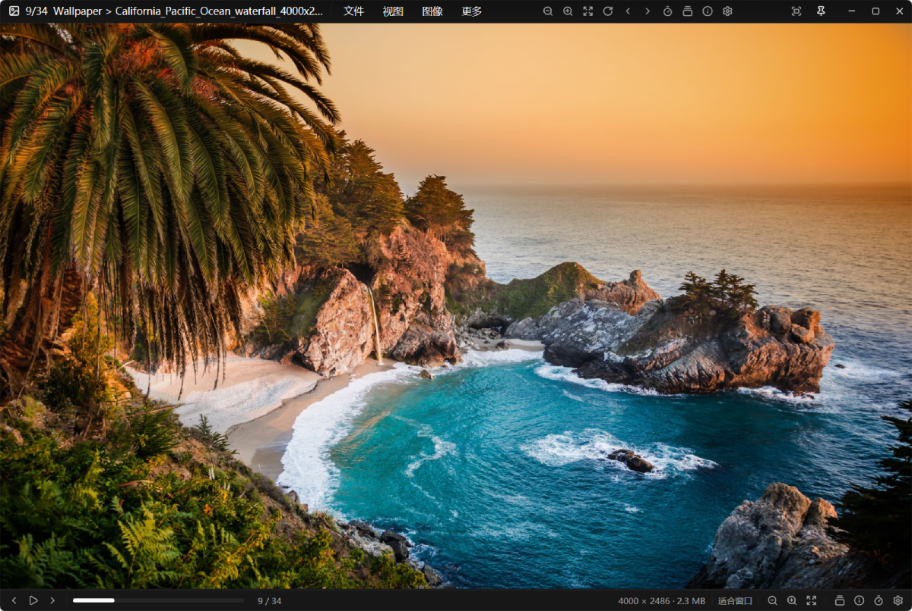

# SeePic

<p align="center">
  
</p>

SeePic 是一个用 **Rust + GPUI** 编写的桌面图片查看器与漫画阅读器。它把「打开快、翻页跟手、
缩略图清晰、内存不失控」放在第一位，适合浏览大尺寸摄影图、几千张的图片文件夹，以及
ZIP / 7Z / RAR / TAR 里的整本漫画。

## 亮点

- **压缩包直接读**：只解析目录、按需读取条目，不解压整个文件。688 MB 的 ZIP 目录解析从约
  2.15 秒降到约 1.6 毫秒。
- **大文件夹不卡**：缩略图只为可见格子解码；JPEG 走 DCT 缩放解码，只做一次 CatmullRom
  缩放，滚动时不会反复淘汰、重解码。
- **动画完整**：GIF 与动态 WebP 逐帧播放，可暂停、单帧前后翻；动态 WebP 首帧先显示，
  其余帧后台解码。
- **内存有上限**：缩略图与页面纹理共享预算；大图解码帧可落到临时文件，翻完整本漫画
  进程内存不会一路增长。

## 功能

- 图片格式：JPEG / PNG / GIF / WebP / BMP / TIFF / TGA / PNM / DDS / HDR / EXR / QOI。
- 压缩包：ZIP / CBZ、7Z / CB7、RAR / CBR、TAR / CBT；加密包会提示输入密码。
- 浏览方式：原始大小（100%）、适合窗口、适合宽度、适合高度、智能双页（左→右 / 左←右）、
  漫画 webtoon（纵向连续滚动）。
- 缩略图胶片条与全屏缩略图网格；网格左侧 A–Z 快速定位，右侧滚动条自动隐藏。
- 阅读位置记忆：重新打开文件夹或压缩包时回到上次看到的那一页。
- 收藏夹：添加当前图片、打开最近添加、独立收藏夹窗口。
- 系统集成：「设置 → 文件关联」注册为图片/漫画的打开方式；资源管理器右键菜单可直接浏览或转换图片
  （Windows 11 中位于「显示更多选项」）。
- 文件管理：复制 / 剪切 / 粘贴图片文件（菜单，或 `Ctrl+X` / `Ctrl+V`；`Ctrl+C` 复制当前图像），
  默认图片文件夹为 `%USERPROFILE%\Pictures\SeePic`。

## 快捷键

以下是默认绑定，均可在「设置 → 快捷键」中修改。

| 按键 | 功能 |
|---|---|
| `←` / `→` | 上一张 / 下一张 |
| `Home` / `End` | 第一张 / 最后一张 |
| `Space` | 向下滚动 / 翻页 |
| `]` / `[` | 下一个 / 上一个文件夹或压缩包 |
| `1` / `2` / `3` / `4` | 100% / 适合窗口 / 适合宽度 / 适合高度 |
| `5` / `z` | 漫画 webtoon / 智能双页（左→右） |
| `Ctrl+=` / `Ctrl+-` | 放大 / 缩小 |
| `0` / `Alt+0` | 原始大小 / 重置缩放 |
| `Ctrl+O` / `F` | 打开文件 / 打开文件夹 |
| `Ctrl+W` | 关闭图像 |
| `F4` | 缩略图栏 |
| `Ctrl+I` 或 `Tab` | 文件 / EXIF 信息窗口 |
| `Alt+I` / `Alt+P` / `Alt+B` | 图像面板 / 幻灯片面板 / 收藏夹 |
| `Ctrl+Shift+P` 或 `F9` | 指令面板 |
| `Ctrl+R` / `Ctrl+Shift+R` | 顺时针 / 逆时针旋转 90° |
| `Ctrl+M` / `Ctrl+F` | 水平翻转 / 垂直翻转 |
| `Ctrl+Shift+0` | 重置旋转与翻转 |
| `Alt+T` | 循环切换透明背景 |
| `Ctrl+C` / `Ctrl+X` / `Ctrl+V` | 复制当前图像 / 剪切图像文件 / 粘贴文件或图像 |
| `Ctrl+Shift+C` | 复制 EXIF 信息 |
| `Ctrl+T` / `Ctrl+P` | 转换图片 / 打印 |
| `Insert` / `Ctrl+Insert` | 复制 / 移动到照片文件夹 |
| `B` / `F3` | 添加到收藏夹 / 打开最近添加的收藏 |
| `Ctrl+1` … `Ctrl+9` / `Ctrl+0` | 幻灯片 1–9 秒 / 停止 |
| `Alt+Enter` | 全屏 |
| `Ctrl+A` | 窗口置顶 |
| `F5` / `F1` / `X` | 设置 / 关于 / 退出 |

## 构建与运行

需要 Rust 1.85+（edition 2024），在 Windows 10/11 上开发与验证。

```text
cargo build --release
target\release\seepic.exe <图片、文件夹或压缩包>
```

Release 构建使用 Windows GUI 子系统，双击启动不会弹出终端窗口。打包后可直接分发：

```text
dist\seepic.exe
dist\seepic-<version>-windows-x64.zip
```

## 项目结构

| 路径 | 内容 |
|---|---|
| `crates/seepic-core` | 与界面无关的纯逻辑：解码、容器与压缩包、导航、缓存、设置、命令表 |
| `crates/seepic-app` | GPUI 界面、菜单与面板、动画播放、缩略图管线 |
| `assets/` | 应用图标（PNG / ICO / RC）与 README 截图 |

## 配置与数据

配置、元信息缓存和窗口位置保存在 `%APPDATA%\SeePic\`：

- `config.json`：阅读偏好、界面模式、快捷键与自定义绑定。
- `meta-cache.json`：文件元信息缓存，避免重复扫描。
- `positions.json`：每个文件夹 / 压缩包的阅读位置。

## 实现要点

- **缩略图**：JPEG 在解码阶段按目标尺寸做 DCT 缩放，其余格式只解一次；随后单次
  CatmullRom 缩放到物理像素，可见项受保护、不会被 LRU 淘汰。
- **解码调度**：可见页优先、并发受限；快速翻页时先出预览尺寸，停下后补全尺寸；
  长时间播放动画时不与主图解码抢线程。
- **缓存预算**：缩略图与页面纹理共用一个内存预算；超过上限按 LRU 回收纹理，并归还
  给窗口而不是泄漏在图集里。
- **大图与动画**：解码帧可映射到临时文件，避免整本漫画常驻内存；动态 WebP 边解边播。
- **压缩包**：ZIP 通过中央目录定位条目，避免 `zip` crate 的整文件扫描；页尺寸探测只读
  条目开头，不为了缩略图解整张图。

## 许可

本项目以 MIT 许可发布，见 `LICENSE`。构建所依赖的第三方组件保留各自的许可，
见 `THIRD-PARTY-NOTICES.md`。
