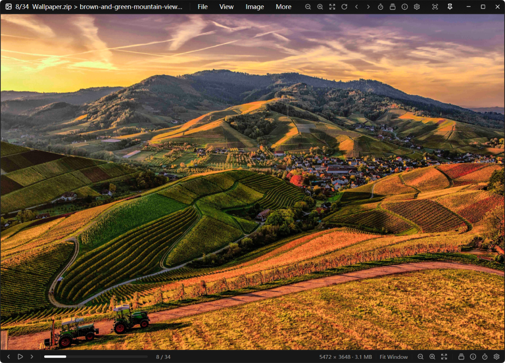

# SeePic

<p align="center">
  
</p>

<p align="center">
  <a href="README.md">English</a> · 简体中文
</p>

SeePic 是一个面向 Windows 的桌面图片查看器与漫画阅读器，使用 **Rust + GPUI** 编写。它把三件事放在第一位：打开快、翻页跟手、浏览大文件夹与压缩包时内存不失控。适合浏览大尺寸摄影图、几千张的图片文件夹，以及 ZIP / 7Z / RAR / TAR 里的整本漫画。

## 亮点

- **压缩包直接读**：只解析目录、按需读取条目，不解压整个文件。688 MB 的 ZIP 目录解析从约 2.15 秒降到约 1.6 毫秒。
- **大文件夹不卡**：缩略图只为可见格子解码；JPEG 走 DCT 缩放解码，只做一次 CatmullRom 缩放，滚动时不会反复淘汰、重解码。
- **动画完整**：GIF 与动态 WebP 逐帧播放，可暂停、单帧前后翻；动态 WebP 首帧先显示，其余帧后台解码。
- **内存有上限**：缩略图与页面纹理共享预算；大图解码帧可落到临时文件，翻完整本漫画进程内存不会一路增长。

## 功能

- **图片格式**：JPEG、PNG、GIF、WebP、AVIF、JPEG XL、BMP、TIFF、TGA、PNM、DDS、HDR、EXR、QOI、ICO 等。
- **压缩包**：ZIP / CBZ、7Z / CB7、RAR / CBR、TAR / CBT；加密包会提示输入密码。
- **浏览方式**：原始大小（100%）、适合窗口、适合宽度、适合高度、智能双页（左→右 / 左←右）、漫画 webtoon（纵向连续滚动）。
- **缩略图**：底部胶片条与全屏缩略图网格；网格左侧 A–Z 快速定位，右侧滚动条自动隐藏。
- **阅读位置记忆**：重新打开文件夹或压缩包时回到上次看到的那一页。
- **收藏夹**：添加当前图片、打开最近添加、独立收藏夹窗口。
- **图像工具**：旋转、翻转、重置、滤镜、插值、亮度 / 对比度 / 饱和度 / Gamma、灰度、棕褐色、通道查看、批量图片转换与“按所见另存”。
- **剪贴板**：复制当前显示的图像、复制/剪切图像文件、把文件或位图粘贴到当前文件夹。
- **系统集成**：把 SeePic 注册为图片 / 漫画的打开方式；在资源管理器右键菜单中加入“用 SeePic 浏览”和“用 SeePic 转换”。
- **界面语言**：跟随 Windows 显示语言，或在设置中选择简体中文、繁体中文、English、日本語、한국어、Français、Deutsch、Español、Русский、Português；未翻译的条目回退为英文。

## 浏览文件夹与压缩包

用「打开文件」打开一张图片、用「打开文件夹」打开目录，或者把文件/文件夹拖进窗口。打开单张图片时会同时载入它所在的文件夹，前后图片可以立即翻看；打开压缩包时则按页列出。方向键与鼠标滚轮翻页，胶片条或缩略图网格可以快速跳转。

标题栏显示容器、当前文件和位置，状态栏显示图像尺寸与当前排序方式；这些都可以在设置中调整。

## 键盘与鼠标

所有命令都可以从顶部菜单、指令面板（`Ctrl+Shift+P`）和设置窗口里找到。默认快捷键列在「设置 → 键盘」中，可直接修改；鼠标操作在「设置 → 鼠标」中配置。右键菜单会显示每个命令当前使用的快捷键。

## 构建与运行

需要 Rust 1.85+（edition 2024），在 Windows 10/11 上开发与验证。

```text
cargo build --release
target\release\seepic.exe <图片、文件夹或压缩包>
```

Release 构建使用 Windows GUI 子系统，双击启动不会弹出终端窗口。发布工作流会把打包结果放到 `dist\`：

```text
dist\seepic.exe
dist\seepic-<version>-windows-x64.zip
```

## 配置与数据

配置以 JSON 保存在 `%APPDATA%\SeePic\config.json`。同一目录下还有信息缓存、阅读位置记录、可选的格式图标，以及程序崩溃时写出的 `panic.log`。「复制到图片文件夹」使用的目录默认是 `%USERPROFILE%\Pictures\SeePic`，第一次使用时会自动创建。

## 说明与限制

- 支持平台为 Windows 10/11。
- 资源管理器中的缩略图预览需要额外的 COM 外壳扩展，当前构建不包含；文件关联与右键菜单通过当前用户注册表实现，不需要管理员权限。
- SeePic 不是完整的图像编辑器；调整项主要用于浏览、按所见另存和转换输出。
- `assets/formats` 下的格式图标是开发用占位素材，发布前请先阅读 `THIRD-PARTY-NOTICES.md`。

## 许可证

SeePic 使用 MIT License。依赖及其许可证见 `LICENSE` 与 `THIRD-PARTY-NOTICES.md`。
